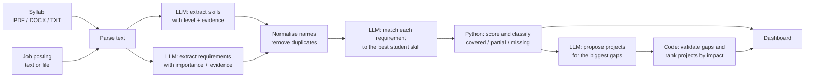

# Course-to-Career Gap Analyzer

An AI-assisted tool that compares what a student has **actually been taught** (course syllabi) with what an **employer asks for** (a job posting). It extracts skills from both sides, scores the gaps with an evidence trail, and recommends ranked portfolio projects to close them.

> **Live demo:** `https://YOUR-FRONTEND.onrender.com` (free tier: the first visit after a quiet period can take about a minute while the server wakes up)

---

## The problem

Students often finish a degree without knowing how their coursework lines up with the jobs they want:

- A **transcript** lists course names and grades, not the skills learned or how deeply.
- A **job posting** mixes real requirements with inflated wish-lists and describes skills in inconsistent words ("ML", "machine learning", "applied ML").
- Courses speak in topics and units; jobs speak in tools and responsibilities, so comparing them by hand is slow and subjective.

Resume scanners only compare keywords on the resume, and a generic chatbot can sound convincing while inventing skills a student never learned. This project aims for an answer that is **consistent, measurable and traceable to the source text**.

## What it does

| Feature | Description |
|---|---|
| Document upload | PDF, DOCX or TXT syllabi, and a job posting pasted or uploaded |
| Skill extraction | Finds the skills each syllabus teaches and grades depth: `exposure`, `working` or `proficient` |
| Requirement extraction | Finds the job's requirements, split into must-have and nice-to-have |
| Name normalisation | Gives common variants one standard name ("Postgres" and "PostgreSQL", "RESTful APIs" and "REST APIs") |
| Alternatives handling | "AWS or GCP" counts as **one** requirement, and the student only needs one of them |
| Gap analysis | Marks every requirement as `covered`, `partial` or `missing`, with evidence from both the job and the coursework |
| Match score | A 0-100 score in which must-have skills count double |
| Visual dashboard | Score ring, radar chart by area, status donut, skill-by-skill bars and a detail table |
| Project recommendations | Ranked portfolio projects with deliverables, difficulty, time estimate and a resume bullet |
| History | Reopen earlier analyses |
| Result reuse | Identical files reuse earlier AI results, which saves time and free-tier quota |
| Swappable AI provider | Anthropic, Gemini, Groq, Ollama or any OpenAI-compatible API, chosen in one config file |

## How it works



**Design principle: the AI extracts and judges, plain code does the math.** Every number on the dashboard (scores, coverage, project impact) is computed by deterministic Python, so it is consistent and explainable. The AI output is also checked: a matched skill must exist in the student's list, and a project can only name gaps that really exist, otherwise they are dropped.

## How scoring works

**Skill level to score**

| Student level | Score |
|---|---|
| exposure (only introduced) | 0.40 |
| working (practised in labs or assignments) | 0.75 |
| proficient (major project or heavy emphasis) | 1.00 |

**Match type to multiplier:** `same` = 1.0, `related` = 0.5, `none` = 0.

**Status:** a requirement is `covered` at 0.70 or above, `partial` from 0.20 up to 0.70, and `missing` below 0.20.

**Overall match score** is the weighted average of the requirement scores, with weights must-have = 2 and nice-to-have = 1, shown as 0-100.

**Project impact** is the share of your total weighted gap that a project closes on its own. Projects overlap, so impact percentages add up to more than 100%.

## Tech stack

| Layer | Technology |
|---|---|
| Frontend | React, Vite, Recharts, Axios |
| Backend | Python, FastAPI, Uvicorn, Pydantic |
| Database | SQLite for local development, PostgreSQL (for example Neon) when deployed, through SQLAlchemy |
| Document parsing | pdfplumber, python-docx |
| AI | Any OpenAI-compatible API (tested with Gemini) or Anthropic, behind a small provider interface |
| Hosting | Render (web service and static site) |

## Project structure

```
career-gap-analyzer/
├── backend/
│   ├── app/
│   │   ├── main.py                  # FastAPI app and CORS
│   │   ├── config.py                # all settings, read from environment variables
│   │   ├── db.py                    # database engine (SQLite or Postgres)
│   │   ├── models/                  # database tables
│   │   ├── routers/                 # documents, skills, jobs, analysis, recommendations
│   │   └── services/
│   │       ├── parsing.py           # PDF / DOCX / TXT to text
│   │       ├── normalize.py         # standard skill names
│   │       ├── skill_extraction.py  # syllabus to skills
│   │       ├── job_extraction.py    # job posting to requirements
│   │       ├── matching.py          # requirement to skill matching
│   │       ├── gap_analysis.py      # scoring and status
│   │       ├── recommendations.py   # project suggestions and ranking
│   │       └── llm/                 # provider interface and implementations
│   ├── requirements.txt
│   └── .env.example
├── frontend/
│   └── src/
│       ├── App.jsx                  # layout and navigation
│       ├── pipeline.js              # runs the backend steps
│       ├── api.js
│       └── components/              # Sidebar, UploadPage, Dashboard, Recommendations, History ...
└── eval/
    ├── cases/                       # human-labelled test cases
    ├── samples/                     # sample syllabi and job postings
    ├── results/                     # saved evaluation runs
    ├── metrics.py                   # scoring helpers
    └── run_eval.py                  # evaluation script
```

## Getting started

### Prerequisites

- Python 3.11 or newer
- Node.js (LTS)
- An API key for an AI provider. A free Gemini key from Google AI Studio works.

### 1. Clone the repository

```bash
git clone https://github.com/YOUR-USERNAME/career-gap-analyzer.git
cd career-gap-analyzer
```

### 2. Backend

**Windows (PowerShell)**
```powershell
cd backend
python -m venv venv
venv\Scripts\activate
pip install -r requirements.txt
copy .env.example .env
notepad .env          # add your API key and model
uvicorn app.main:app --reload
```

The API runs at `http://localhost:8000`, and interactive docs are at `http://localhost:8000/docs`.

### 3. Frontend

In a second terminal:
```bash
cd frontend
npm install
npm run dev
```
Open `http://localhost:5173` (use `localhost`, not `127.0.0.1`, because the backend allows that address).

### 4. Try it

Upload `eval/samples/syllabus_dbms.txt` as the syllabus and paste the text of `eval/samples/job_backend_engineer.txt` as the job posting.

## Configuration

All settings are environment variables (a `.env` file locally, or the host's settings when deployed). **Never commit `.env`.**

| Variable | Purpose | Example |
|---|---|---|
| `LLM_PROVIDER` | `anthropic` or `openai_compatible` | `openai_compatible` |
| `LLM_API_KEY` | API key for the provider | (secret) |
| `LLM_MODEL` | Model name | `gemini-3.5-flash-lite` |
| `LLM_BASE_URL` | Only for OpenAI-compatible providers | `https://generativelanguage.googleapis.com/v1beta/openai/` |
| `LLM_REASONING_EFFORT` | Optional. Lowers Gemini "thinking" time (`low` or `none`, depending on the model) | `low` |
| `LLM_MAX_RPM` | Max AI calls per minute. Set a little under your free-tier limit | `4` |
| `DATABASE_URL` | Defaults to local SQLite. Use a PostgreSQL URL when deployed | `sqlite:///./app.db` |
| `FRONTEND_ORIGIN` | Allowed website addresses, comma-separated | `http://localhost:5173` |

For the frontend, `VITE_API_URL` sets the backend address (default `http://localhost:8000`) and is read at build time.

Model names and free-tier limits change often, so check your provider's current documentation.

## API reference

Interactive documentation is generated at `/docs`.

| Method | Endpoint | Purpose |
|---|---|---|
| POST | `/documents` | Upload a file (`kind` = `syllabus`, `transcript` or `job`) |
| GET | `/documents` | List uploaded documents |
| GET | `/documents/{id}` | Get one document's text |
| POST | `/documents/{id}/extract-skills` | Extract skills from a syllabus |
| GET | `/documents/{id}/skills` | Read extracted skills |
| POST | `/documents/{id}/extract-requirements` | Extract requirements from a job posting |
| GET | `/documents/{id}/requirements` | Read extracted requirements |
| POST | `/analysis` | Run the gap analysis (`job_document_id`, `syllabus_document_ids`) |
| GET | `/analysis` | List past analyses |
| GET | `/analysis/{id}` | Get one analysis |
| POST | `/analysis/{id}/recommendations` | Generate project recommendations |
| GET | `/analysis/{id}/recommendations` | Read saved recommendations |
| GET | `/health` | Health check |

Extraction, analysis and recommendation endpoints reuse earlier results for identical input. Add `?force=true` to recompute, for example after changing a prompt.

## Evaluation

The `eval/` folder measures how well the system agrees with human labels, and is the way to check changes objectively.

```bash
cd backend
python ../eval/run_eval.py --label my-run     # run all cases and save results
python ../eval/run_eval.py --compare          # table of all saved runs
```

**Metrics:** precision, recall and F1 for skill and requirement extraction; level accuracy; gap-status accuracy with a confusion matrix; and coverage-index error (covered = 1, partial = 0.5, missing = 0, must-have counts double). Labelling rules are in [`eval/README.md`](eval/README.md).

**Results so far** (3 starter cases, 27 labelled requirements, Gemini 3.5 Flash-Lite):

| Run | Skill precision | Skill recall | Skill F1 | Requirement F1 | Gap status accuracy |
|---|---|---|---|---|---|
| Baseline prompts | 91% | 66% | 76% | 100% | 85% |
| After making skill extraction more fine-grained | 92% | 98% | 95% | 100% | 96% |

**What the error analysis showed:** most wrong "missing" labels came from skills the extractor had grouped too coarsely (it listed "CSS" but not "Flexbox" or "Responsive Design"), so the matcher could not find them. Asking for fine-grained skills, and treating "introductory" topics as `exposure`, fixed most of it.

> **Read these numbers carefully.** The three cases were drafted as examples and the prompt was tuned on the same cases, so this is a development-set result, not an independent test. Skill precision also changed definition between runs, because duplicate names for an already-labelled skill are no longer counted as errors, so compare recall and status accuracy across runs. A stronger evaluation would add more cases, labelled independently before running the system.

## Deployment

The app runs on free tiers: **Render** for the backend (web service) and frontend (static site), and **Neon** for PostgreSQL.

**Backend (Render web service)**

| Setting | Value |
|---|---|
| Root directory | `backend` |
| Build command | `pip install -r requirements.txt` |
| Start command | `uvicorn app.main:app --host 0.0.0.0 --port $PORT` |
| Environment variables | Those in [Configuration](#configuration), with `FRONTEND_ORIGIN` set to the live frontend address |

**Frontend (Render static site)**

| Setting | Value |
|---|---|
| Root directory | `frontend` |
| Build command | `npm install && npm run build` |
| Publish directory | `dist` |
| Environment variable | `VITE_API_URL` = the backend address |

**Free-tier behaviour:** a free web service sleeps after about 15 minutes without traffic and takes roughly a minute to wake. Without an external database, SQLite data is lost on restart, which is why a free Postgres database is recommended.

**Security notes**
- Keep all keys and database URLs in the host's environment settings, never in the repository.
- Uploads are limited to 5 MB per file.
- History is shared between everyone using one deployment, so a public instance should only be used with sample data, or protected with per-user IDs before wider use.
- Uploaded text is sent to the configured AI provider. Free tiers of some providers may use submitted content, so avoid personal documents.

## Known limitations

- Scanned (image-only) PDFs are not supported, because there is no OCR step. Use text-based PDFs.
- A requirement that joins two things with "and" can be marked `covered` when the coursework covers only one half.
- Quality depends on the AI model. Accuracy has been measured on one model and a small set of cases.
- Skill depth is inferred from syllabus wording, so a syllabus does not prove what a student actually learned or retained.
- Syllabus and job text is truncated at about 12,000 characters per document.
- Free AI and hosting tiers have rate limits, so a run can pause while it waits.

## Future work

- More evaluation cases, labelled independently, with inter-annotator agreement
- Compare several job postings side by side
- A week-by-week learning roadmap for the top gaps
- OCR for scanned PDFs
- Per-user accounts or anonymous session IDs so each visitor sees only their own history
- Compare several AI models on the same evaluation set

## Author

Built by **Anjani Kavya**.

